<p align="center">
  <picture>
    <source media="(prefers-color-scheme: dark)" srcset=".github/assets/openbooks-logo-dark.svg" />
    
  </picture>
</p>

<p align="center">
  <strong>The open business suite. Run on open books.</strong><br />
  Accounting, operations, payroll, and HR for businesses of every size—from solo operators<br />
  sending their first invoice to multi-entity corporations with thousands of employees.<br />
  Start simple. Turn on new capabilities as you grow. Never outgrow your books.
</p>

<p align="center">
  <a href="https://github.com/braedonsaunders/openbooks/actions/workflows/test.yml"></a>
  <a href="https://github.com/braedonsaunders/openbooks/actions/workflows/trust.yml"></a>
  
  
  <a href="https://github.com/braedonsaunders/openbooks/releases"></a>
  <a href="https://github.com/braedonsaunders/openbooks/pkgs/container/openbooks"></a>
  <a href="LICENSE"></a>
  
</p>

<p align="center">
  <a href="#why-businesses-choose-openbooks">Why OpenBooks</a> ·
  <a href="#see-openbooks-in-action">Screenshots</a> ·
  <a href="#financial-rigor-you-can-hand-to-your-auditor">Financial Rigor</a> ·
  <a href="#run-it">Install with Docker</a> ·
  <a href="#what-is-implemented">Capabilities</a> ·
  <a href="TRUST.md">Trust</a> ·
  <a href="CONTRIBUTING.md">Contribute</a>
</p>

<p align="center">
  
</p>

---

## Why businesses choose OpenBooks

Every growing business hits the same wall. You start on simple bookkeeping software, and then you add a second tool for payroll, a third for inventory or project tracking, a fourth for approvals and expenses, and spreadsheets to hold it all together. Before long, your team is typing the same numbers into four systems, your subledgers don't match your balance sheet, and month-end close takes two weeks. When you finally look at an enterprise ERP, you are met with six-figure implementation quotes, per-seat licensing traps, and clunky software from twenty years ago.

**OpenBooks is built to end that trade-off.**

It is a complete, modern business and accounting suite that scales from a one-person shop to a multi-entity organization—all in one place, on one set of books:

* **Simple on day one, enterprise-ready when you need it:** If you just need customers, invoices, bills, bank reconciliation, and financial statements, that is all you see. As your business grows, flip a switch in **Company Settings → Features** to turn on inventory, warehouse management, manufacturing, project and construction billing, subscriptions, HR, benefits, payroll, or multi-company consolidation—without ever migrating your data to a new platform.
* **One connected flow from operations to the general ledger:** Approved timesheets, warehouse receipts, progress billing applications with retainage, and committed payroll runs flow directly into your job costs, subledgers, and financial statements without re-keying or CSV imports. Click any figure on your Profit & Loss or Balance Sheet and drill straight down to the register, source document, and journal entry behind it.
* **Books that never drift out of balance:** If you have ever chased a mystery discrepancy between your aged receivables report and your balance sheet, or discovered someone edited an invoice in a closed quarter, you know how fragile most accounting software is. OpenBooks enforces double-entry balance within every legal entity, period locks, and an append-only audit trail at the database level itself—so an unbalanced entry, a lost penny, or an unrecorded edit simply cannot be saved.
* **Your server, your data, zero per-seat fees:** OpenBooks is open-source (AGPL-3.0-or-later) and self-hosted. Give every employee, field worker, manager, approver, and accountant the access they need without your software bill multiplying every time you hire.

---

## See OpenBooks in action

<p align="center">
  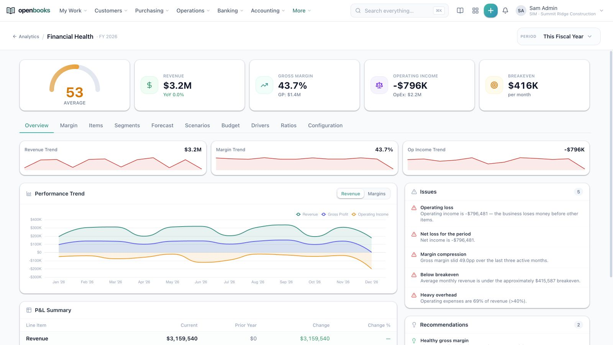
</p>
<p align="center"><sub>Move from headline performance to trends, exceptions, recommendations, and the underlying financial statements in one workspace.</sub></p>

<table>
  <tr>
    <td width="50%">
      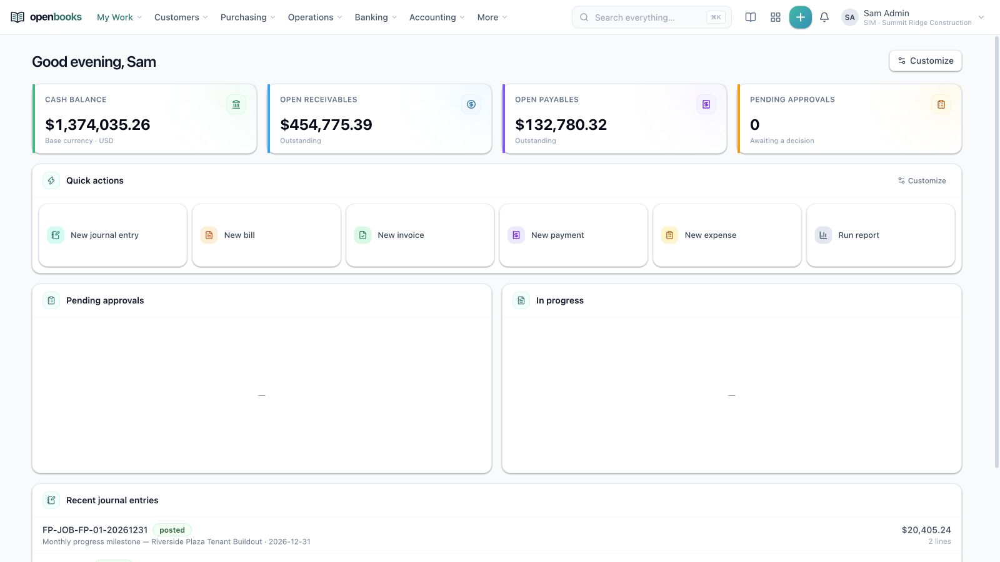<br />
      <sub><strong>Personalized workspace:</strong> Cash, receivables, payables, quick actions, approvals, and recent accounting activity.</sub>
    </td>
    <td width="50%">
      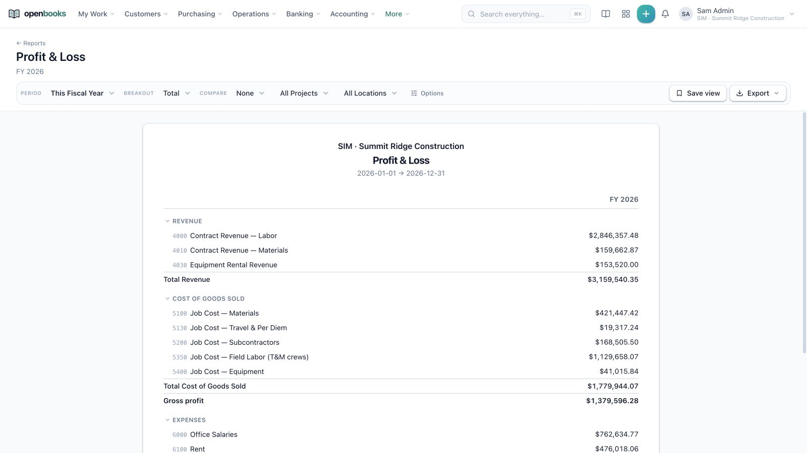<br />
      <sub><strong>Financial reporting:</strong> Drillable statements with dimensions, saved views, comparisons, and exports.</sub>
    </td>
  </tr>
  <tr>
    <td width="50%">
      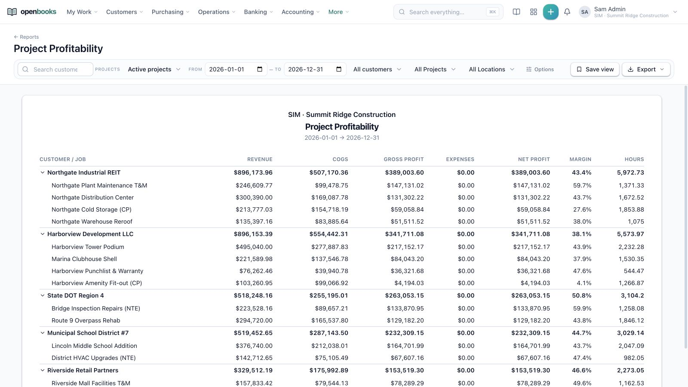<br />
      <sub><strong>Project profitability:</strong> Revenue, cost, margin, profit, and hours from customer down to job.</sub>
    </td>
    <td width="50%">
      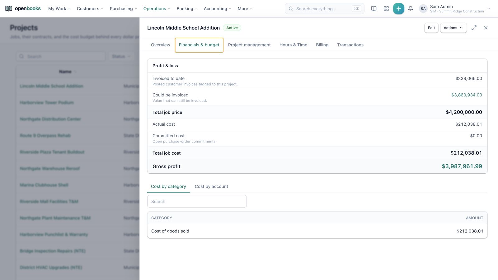<br />
      <sub><strong>Project cockpit:</strong> Contract value, billable balance, actual and committed costs, and gross profit.</sub>
    </td>
  </tr>
  <tr>
    <td width="50%">
      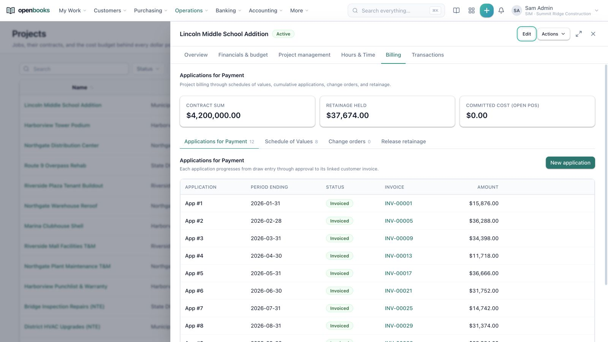<br />
      <sub><strong>Project billing:</strong> Applications, schedules of values, change orders, and retainage stay inside the project record.</sub>
    </td>
    <td width="50%">
      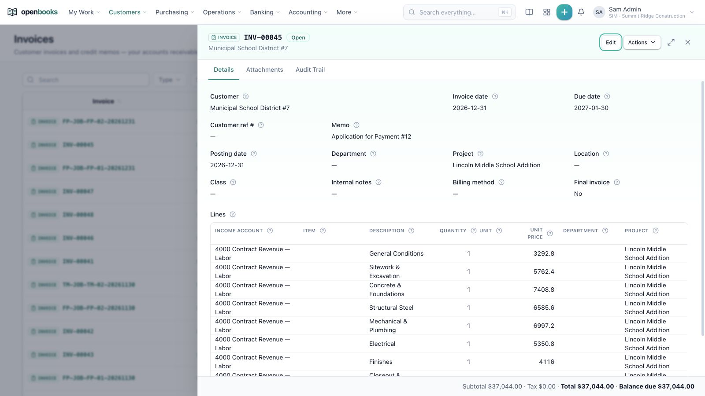<br />
      <sub><strong>Connected invoices:</strong> Approved applications become regular customer invoices with project, line, posting, and audit context.</sub>
    </td>
  </tr>
</table>

<p align="center"><sub>Light mode is shown above. Screenshots use the built-in synthetic Summit Ridge Construction demo; no customer data is shown.</sub></p>

<details>
<summary><strong>Prefer dark mode?</strong> View the same workflows in OpenBooks dark mode.</summary>
<br />
<p align="center">
  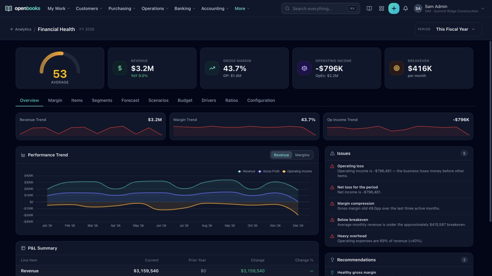
</p>
<table>
  <tr>
    <td width="50%">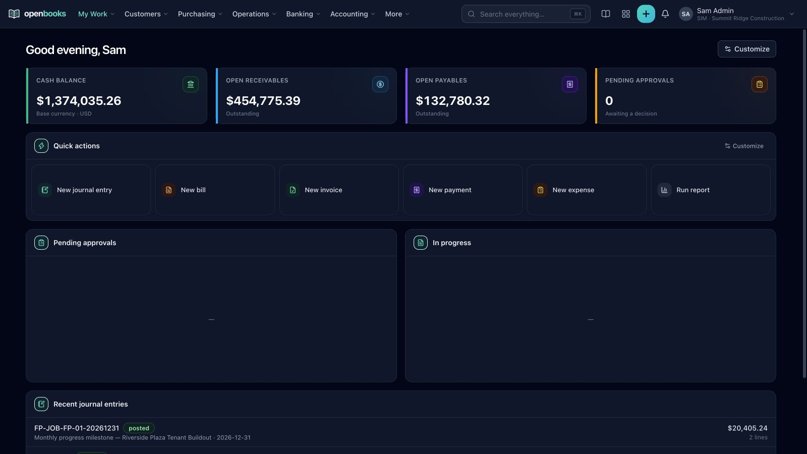</td>
    <td width="50%">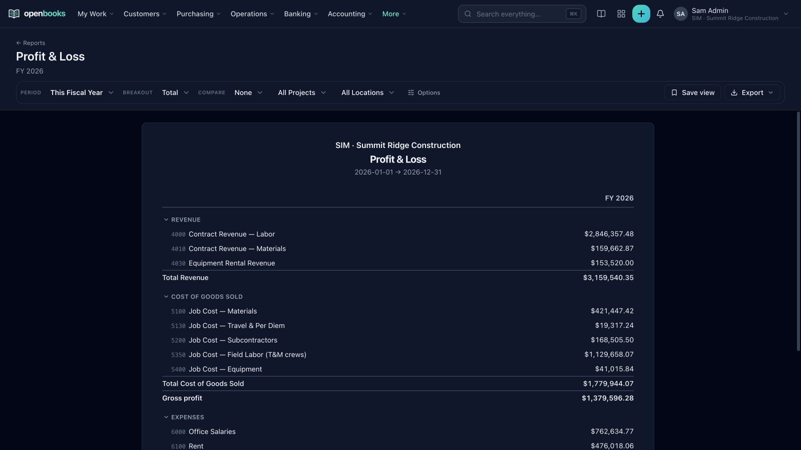</td>
  </tr>
  <tr>
    <td width="50%">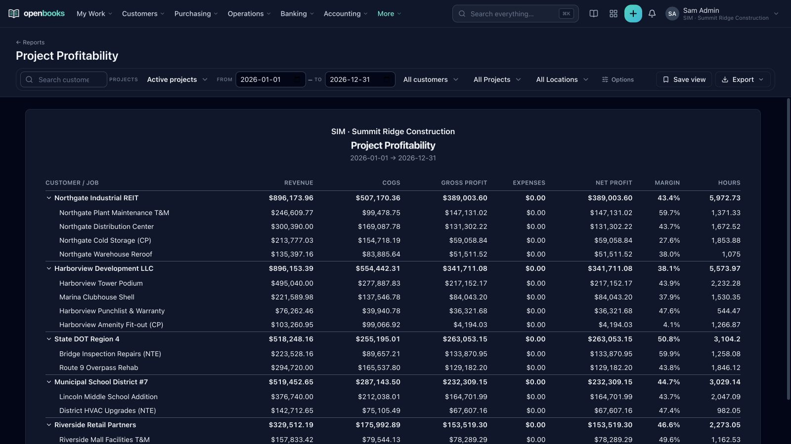</td>
    <td width="50%">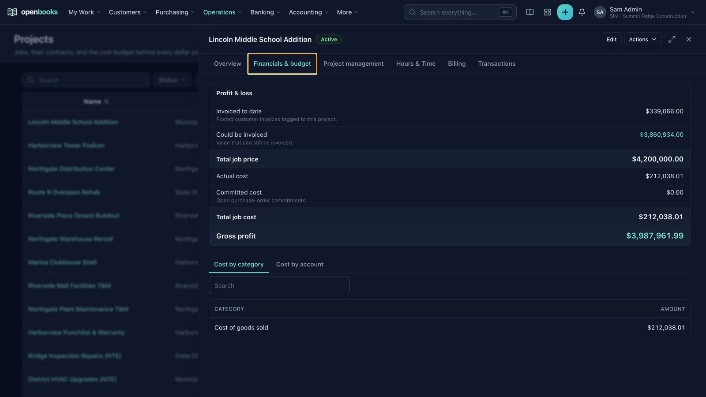</td>
  </tr>
  <tr>
    <td width="50%">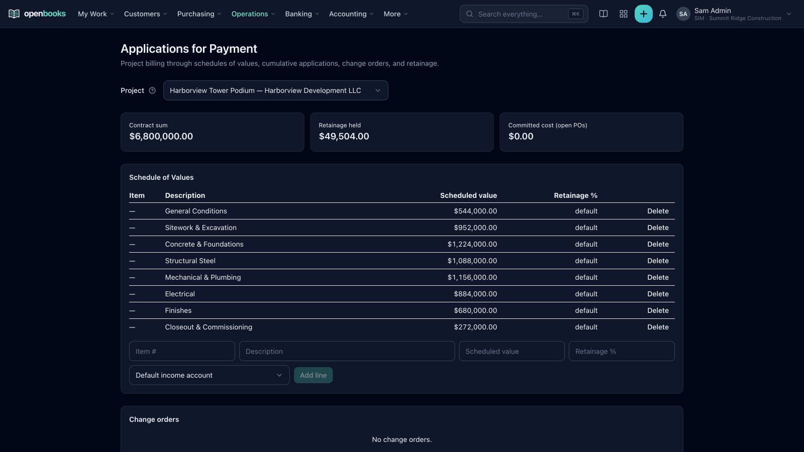</td>
    <td width="50%">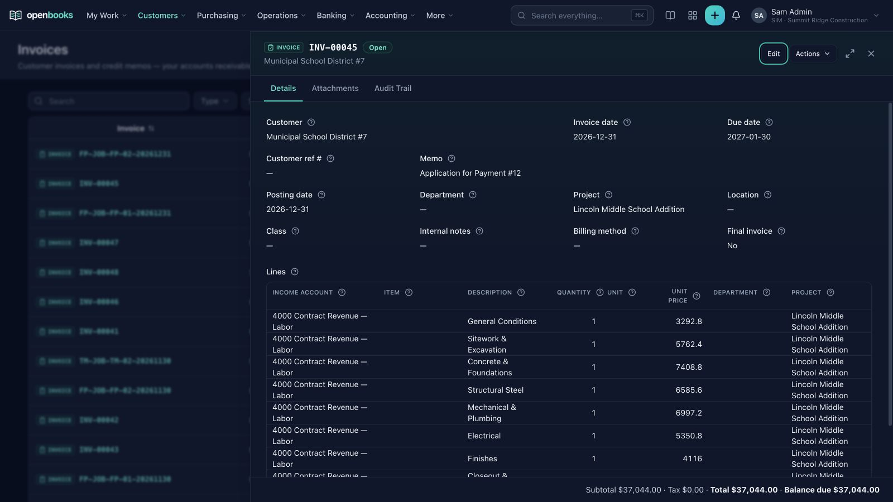</td>
  </tr>
</table>
</details>

---

## Financial rigor you can hand to your auditor

Accountants and controllers are right to be skeptical of new accounting software. Anyone can draw a pretty dashboard; what matters at year-end is whether the numbers are right, whether the controls hold, and whether you can prove both.

OpenBooks is built to institutional accounting standards:

* **Subledgers tie to the General Ledger:** Customer receivables, vendor payables, inventory cost layers, fixed-asset schedules, and payroll liabilities reconcile directly to their control accounts.
* **Real period close and segregation of duties:** Close Accounts Receivable, Accounts Payable, and the General Ledger independently so your team can keep working while finance finalizes adjustments. Approval workflows enforce quorum, delegation, and prevent self-approval—so the person who submits a bill, journal, leave request, or raise cannot be the one who approves it.
* **Immutable history and proper reversals:** Posted transactions cannot be silently overwritten or deleted. Corrections happen the way an accountant expects—through governed reversals and replacement entries that keep the original, the reversal, and the replacement clearly linked in the audit trail.
* **Posted journal vs. downstream effects:** When a document posts, its journal commits immediately while downstream stock and recognition projections track through a durable outbox visible right on the document drawer. Any incomplete effect surfaces in close readiness and blocks hard GL close for the affected scope until resolved. See the [posting-effects runbook](docs/operations/posting-effects.md).
* **Multi-entity, multi-currency, and multi-book:** Run a single company or a global group of subsidiaries. Maintain separate primary, statutory, and tax books; automate intercompany eliminations, non-controlling interests, and currency translation adjustments; and produce both standalone entity statements and consolidated group financials.
* **Continuously tested against US GAAP and IFRS:** OpenBooks continuously checks its own accounting against 106 executable test cases covering **ASC 606 / IFRS 15** (revenue recognition), **ASC 842 / IFRS 16** (leases), **IAS 2 / ASC 330** (inventory costing & write-downs), **IAS 21** (foreign currency), **ASC 360 / IAS 16** (fixed assets & impairment), and **ASC 740 / IAS 12** (income tax provisions)—and publishes the results openly in [TRUST.md](TRUST.md), the [standards matrix](docs/trust/conformance-matrix.md), and the [Audit-Assertion Control Matrix](AUDIT-CONTROLS.md).

**Start with a sample company, explore the workflows, then evaluate it with parallel books.** OpenBooks is alpha software with explicit accounting controls, but it has not completed an independent accounting or security certification. That distinction matters when choosing financial software.

---

## Run it

### Install the prebuilt Docker image (recommended)

Use [Docker with Compose](https://docs.docker.com/compose/install/) and `curl` in a Linux, macOS, or Windows WSL2 terminal. This single command downloads the latest deployment files, pulls the [published OpenBooks image](https://github.com/braedonsaunders/openbooks/pkgs/container/openbooks), resolves the official release to an immutable image digest, and starts the stack:

```bash
mkdir -p openbooks/scripts && cd openbooks && curl -fL https://raw.githubusercontent.com/braedonsaunders/openbooks/main/compose.yaml -o compose.yaml && curl -fL https://raw.githubusercontent.com/braedonsaunders/openbooks/main/scripts/compose-up.sh -o scripts/compose-up.sh && sh ./scripts/compose-up.sh
```

Choose your organization's ISO country and base currency when prompted. The installer generates credentials, starts PostgreSQL 16, Redis 7, MinIO, the web app, and the background worker, applies migrations, and prints the URL and first administrator login after health checks pass.

For an unattended first install:

```bash
mkdir -p openbooks/scripts && cd openbooks && curl -fL https://raw.githubusercontent.com/braedonsaunders/openbooks/main/compose.yaml -o compose.yaml && curl -fL https://raw.githubusercontent.com/braedonsaunders/openbooks/main/scripts/compose-up.sh -o scripts/compose-up.sh && ORG_COUNTRY=US ORG_CURRENCY=USD sh ./scripts/compose-up.sh
```

**Open <http://localhost:4780>.** Sign in with the printed credentials and follow the company setup wizard: identity, industry, workspace profile, fiscal calendar, chart of accounts, and features. On the wizard's launch step, you can check **Create an industry sample company** to spin up a separate, populated demo workspace right away—or create and switch into any of the 11 sample companies at any time from **Setup → Company → Industry sample company**.

Bootstrap provisions separate database roles for migrations, tenant requests, and installation-wide maintenance. Generated secrets stay in `.env.compose`, created with owner-only permissions. Keep that file private and back it up securely.

### A first session that shows how it fits together

1. Finish the setup wizard (choosing **Create an industry sample company** on the launch step, or opening **Setup → Company → Industry sample company** afterward) to explore a realistic, populated business without touching your live books.
2. Open the executive dashboard and drill into a Profit & Loss statement.
3. Click into a customer invoice to inspect its journal entry, payment applications, and related project activity.
4. Explore purchasing, inventory, payroll, approvals, and the audit log.
5. Before importing live balances, validate your chart of accounts, currencies, tax and payroll settings, posting rules, permissions, and opening-balance reconciliation.

### Keep your evaluation easy to operate

```bash
# Service status and worker health
docker compose --env-file .env.compose ps
curl 'http://localhost:4780/api/v1/health?include=worker'

# Follow application and worker activity
docker compose --env-file .env.compose logs -f web worker

# Stop while preserving the named data volumes
docker compose --env-file .env.compose down
```

`down -v` deletes the data volumes. Treat upgrades as reviewed releases: [upgrade runbook](docs/operations/upgrades.md). Before exposing an installation beyond localhost, configure TLS, backups, monitoring, email, and secret management using [SECURITY.md](SECURITY.md) and the [backup/restore runbook](docs/operations/backup-restore.md). Compose runs on one host; [the HA reference](deploy/ha) describes separately operated infrastructure for a replicated application tier.

---

## What is implemented

OpenBooks is accounting-first, with connected operating modules. Optional features are controlled through the single **Company Settings → Features** switchboard; disabling a feature preserves historical data and audit trails. Capabilities below describe code in the repository; they are not a promise that every business or jurisdiction is ready to adopt without validation.

| Your work | Connected capabilities |
| --- | --- |
| **Accounting and close** | Double-entry journals, chart of accounts, dimensions and custom segments, budgets, open items, controlled reversals/corrections, close tasks, approvals, per-module period locks, controlled reopen, allocation rules, continuous-close exception checks, and internal billing |
| **Multiple entities and currencies** | Legal entities, multiple accounting books, paired intercompany transactions, transfer pricing, netting and settlement runs, FX evidence/revaluation, ownership-based consolidation (full, proportionate, equity method, non-controlling interests), auto-elimination, and consolidated reporting |
| **Sales and receivables** | CRM leads and pipeline, sales territories, quotes, sales orders, pricing tiers, credit holds, customer invoices, credit memos, receipts, promotions, cash sales/refunds with daily till close-out (tips, card fees, cash over/short), gift cards/store credit, dunning, and customer balances |
| **Customer self-service and commerce** | Passwordless customer portal, invoice/PDF access, saved payment methods, subscription controls, order tracking, returns, gift-card lookup, and sales-channel connections (including Shopify) |
| **Subscriptions and revenue** | Versioned plans and components, trials, amendments, renewals, metered usage rating, prepaid usage and breakage, quote-to-cash, consolidated billing, normalized SaaS metrics (MRR, ARR, NRR, churn), revenue contracts, ASC 606 / IFRS 15 recognition schedules, rebates, and capitalized contract costs |
| **Purchasing and payables** | Purchase orders, 3-way receipt/bill auto-matching, received-not-billed (GRNI) clearing, vendor bills/credits, AP capture, payments, purchasing controls, employee expense reports, corporate cards, expenses, and prepaid expense amortization |
| **Banking and collections** | Statement imports (BAI2, CAMT.053, MT940), automated matching, reconciliation, cash reporting, configurable bank feeds, payment runs and bank files (NACHA, CPA005, SEPA, BACS, Zengin, CNAB240, CEMTEX, RBC STD152), provider settlements, hosted payment links, and direct debit |
| **Projects and construction** | Job costing, budgets, committed cost, labor rates, overhead absorption, profitability, project progress, earned-unbilled accrual, staffing and retainers, AIA schedules of values, change orders, progress applications, retainage, signed field tickets, and subcontractor COI / lien-waiver payment gates |
| **Inventory** | Stock locations, FIFO/average/standard costing, landed cost, cost-layer inquiry, NRV write-downs, lot/serial and combined tracking, quality holds and quarantine, consignment and subcontract custody, ABC cycles, blind counts with independent recounts, item variants, and inventory/GL reconciliation |
| **Warehouse and shipping** | Barcode-backed receive/putaway/pick/pack/count tasks, execution waves, short-pick release, physical handling units, audited bin moves, pack confirmation, shipping rates/labels/tracking, drop shipping, RMA returns, and demand planning |
| **Manufacturing** | Standalone operator workspace, BOMs, versioned routings, work centers/rates, work orders, material issue/backflush, tracked output receipts, normal scrap capture, WIP/cost relief, material/labor/overhead variances, MRP firm/convert/dismiss, and advisory capacity planning |
| **Assets and equipment** | Asset registers, componentization, purchase proposals, construction in progress (CIP), depreciation methods/books, impairment, remeasurement, disposal, maintenance/insurance tracking, and ASC 842 / IFRS 16 lease accounting |
| **People, HR, benefits, and payroll** | Employee records, positions and headcount plans, recruitment and offer signing, onboarding/offboarding/transfer checklists, performance reviews and calibration, compensation bands and merit cycles, benefits enrollment and incentive settlement, qualifications/training, shift scheduling, geofenced field clock, self-service, time/leave, pay-run readiness, 14-country statutory calculations, automatic retro pay, parallel-run reconciliation, remittances, and declared filing exports |
| **Tax** | Tax configuration (inclusive, compound, reverse-charge, withholding), jurisdiction-specific workpapers, return mappings, ASC 740 / IAS 12 income-tax provisions, cross-border and place-of-supply evidence, EN 16931 electronic-invoice profiles, and contractor withholding; filing availability varies by pack |
| **Property and nonprofit** | Properties, units, leases, straight-line rent schedules, CAM, and security deposits; nonprofit funds, gifts, grants, pledges, donor restrictions and releases, encumbrances, and functional expense reporting |
| **Reporting, scheduling, and automation** | Shared report engine, custom report builder, period/dimension filters, saved views, drill-through, Excel/PDF exports, dashboards, schedule boards, standalone schedule PDFs, recipient review, rich-text email messages, visual approval flows, scheduled jobs, production sandboxes, and sandboxed QuickJS extensions |
| **Migration and synchronization** | Guided migration workspace, source connections, native record imports, synchronization history, reconciliation evidence, and source-specific connector controls |

Eleven built-in [industry sample companies](docs/operations/industry-demo-companies.md)—covering General Business, Construction, Professional Services, Engineering & Architecture, Software & SaaS, Accounting Firms, Wholesale Distribution, Property Management, Nonprofit, Manufacturing, and Healthcare—provide separate synthetic preview tenants that you can launch from the setup wizard or from **Setup → Company** and switch between via the account menu.

### Migrating from another system

Source connectors and migration services exist for:

- NetSuite
- QuickBooks Online
- QuickBooks Desktop Web Connector
- Xero
- ERPNext
- Odoo
- Microsoft Dynamics

Coverage differs by source and record type. Treat a migration as a controlled project: use an isolated target, review exceptions, reconcile subledgers and statements, and retain migration evidence before cutover.

### Localization you can inspect

Payroll packs are registered for AU, BR, CA, DE, ES, FR, GB, IE, IT, JP, NL, PL, SG, and US. **A country name is not a universal compliance claim.** Loaded tax years, regional calculations, required employer/employee inputs, filing formats, corrections, and remittance schedules have distinct scopes.

A 52-pack return-workpaper library spans 41 installable country tax packs. Tax packs are configurable preparation workpapers, not a promise of direct electronic filing, government approval, or complete local coverage.

Electronic invoicing provides selectable standards profiles, and contractor withholding uses schemes declared by the country tax packs. See the [activation and operating guide](docs/operations/einvoicing-and-contractor-withholding.md) for legal-entity configuration and native invoice, payment, and correction flows.

Generate the source-labelled capability inventory with:

```bash
npm ci
node --import tsx scripts/localization-support-scope.ts > localization-support.json
```

Follow the [localization adoption guide](docs/operations/localization.md) before statutory use. The interface has English, German, Spanish, French, Japanese, Brazilian Portuguese, and Chinese message catalogs; statutory coverage is independent of interface language.

---

## Architecture & Development

OpenBooks is a TypeScript monorepo with a Next.js application, a 73-module bounded domain engine, a PostgreSQL accounting kernel, and shared workspaces. Engine module dependencies form an enforced acyclic graph; application adapters use named package contracts.

| Layer | Implementation |
| --- | --- |
| Runtime | Node.js 24 |
| Web | Next.js 16.3, React 19, Tailwind CSS 4 |
| Language | TypeScript 6.0 workspace toolchain |
| Data | PostgreSQL 16, Drizzle ORM, SQL controls, and forward migrations |
| Background work | Redis 7, BullMQ, and a separate worker |
| Files | S3-compatible storage; MinIO in Compose |
| Money | PostgreSQL `numeric(19,4)` values and exact BigInt decimal/rational helpers |
| Extensions | QuickJS WASM sandbox, native configuration, and visual workflow machinery |

See [engine module design](docs/design/engine-modules.md), [financial operation boundaries](docs/design/financial-operation-boundaries.md), and [CONTRIBUTING.md](CONTRIBUTING.md) for local environment and database setup:

```bash
npm ci
npm run check:engine-boundaries
npm run check:engine-public-api
```

## Community & License

If OpenBooks is useful to you, **star the repository and share a workflow you tried**. Screenshots, clear bug reports with synthetic inputs, localization evidence, documentation, and code contributions all help the next organization evaluate it honestly. See [issues](https://github.com/braedonsaunders/openbooks/issues) and [CONTRIBUTING.md](CONTRIBUTING.md).

[AGPL-3.0-or-later](LICENSE). Free to use, inspect, and modify under its terms. If you modify and offer it over a network, the licence's source-availability requirements apply. Review the licence for your distribution and hosting model.
